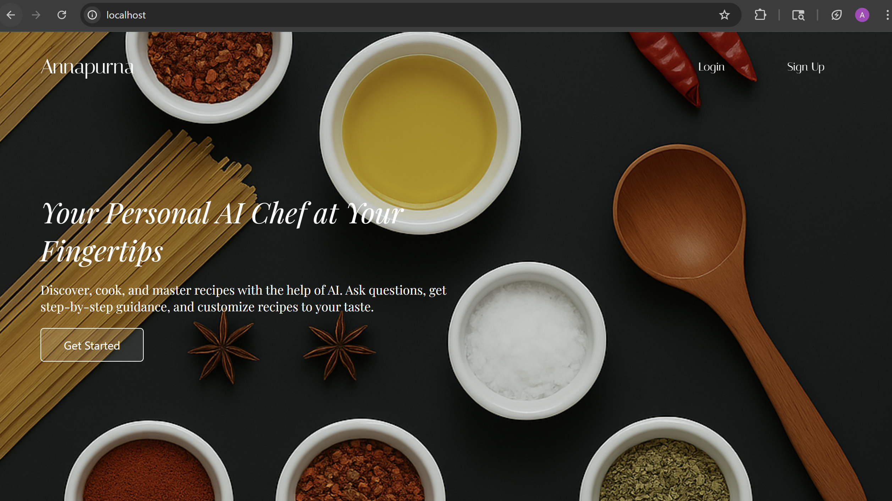
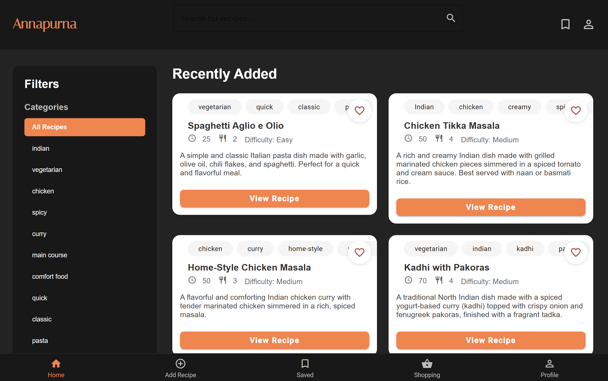
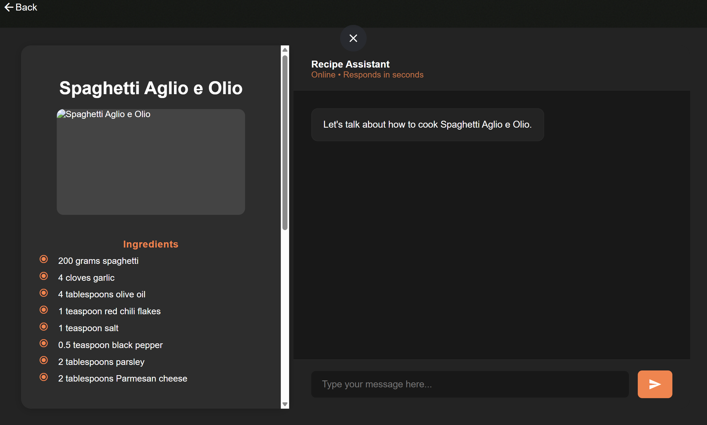
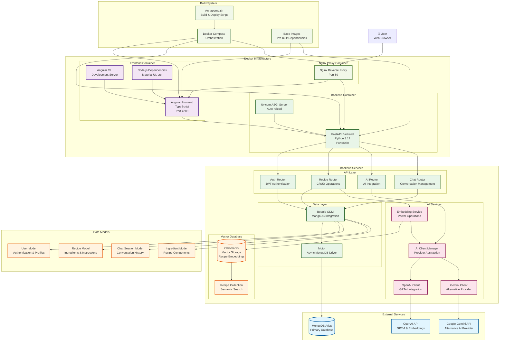

# Annapurna

Annapurna is a modern web application that combines AI capabilities with a user-friendly interface. The project aims to provide intelligent services through a robust backend and an intuitive frontend.





## Tech Stack

### Backend
- **Framework**: FastAPI (Python)
- **Database**: MongoDB with Beanie ODM
- **AI Integration**: OpenAI API
- **Vector Database**: ChromaDB
- **Authentication**: JWT (JSON Web Tokens)
- **Other Dependencies**:
  - Uvicorn (ASGI server)
  - Python-dotenv (Environment management)
  - Pydantic (Data validation)

### Frontend
- **Framework**: Angular
- **Language**: TypeScript
- **Build Tool**: Angular CLI

## Project Structure
```
.
├── backend/           # FastAPI backend service
│   ├── core/         # Core functionality
│   ├── crud/         # Database operations
│   ├── models/       # Data models
│   ├── routers/      # API routes
│   ├── schemas/      # Pydantic schemas
│   └── scripts/      # Utility scripts
├── frontend/         # Angular frontend application
│   └── annapurna-app/
├── baseimgs/         # Base images for the project
├── scripts/          # Project-wide scripts
└── docker-compose.yml # Docker configuration
```



## Setup and Installation

### Prerequisites
- Docker and Docker Compose
- Node.js (for frontend development)
- Python 3.8+ (for backend development)

### Environment Setup
1. Copy the environment file:
   ```bash
   cp .env.sample .env
   ```
2. Update the `.env` file with your configuration values

### Running with Docker (Recommended)
1. Build the baseimgs:
   ```bash
   ./annapurna.sh build baseimgs
   ```
2. Build the dev images
   ```bash
   ./annapurna.sh build dev
   ```
3. Run the Dev images
   ```bash
   ./annapurna.sh start dev
   ```
4. Finally, when you want to bring the images down and remove any orphan containers
   ```bash
   ./annapurna.sh stop
   ```

## Development
- The application will be loaded at: `http://localhost`
- API documentation (Swagger UI) will be available at: `http://localhost:8080/docs`

## Contributing
Please read our contributing guidelines before submitting pull requests.

## License
[Add your license information here]
